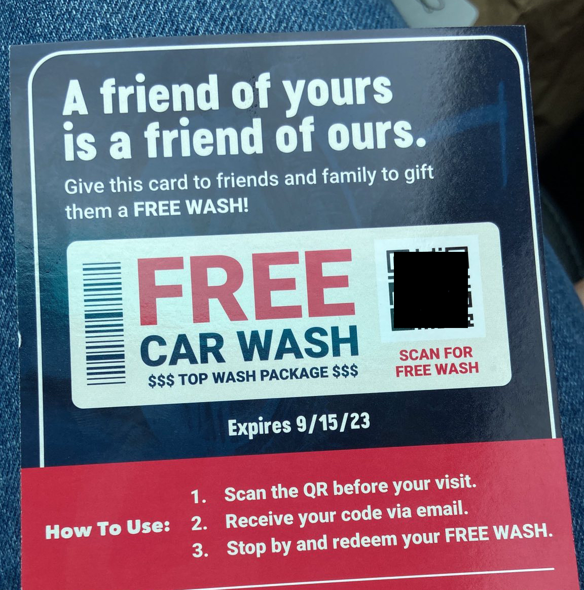
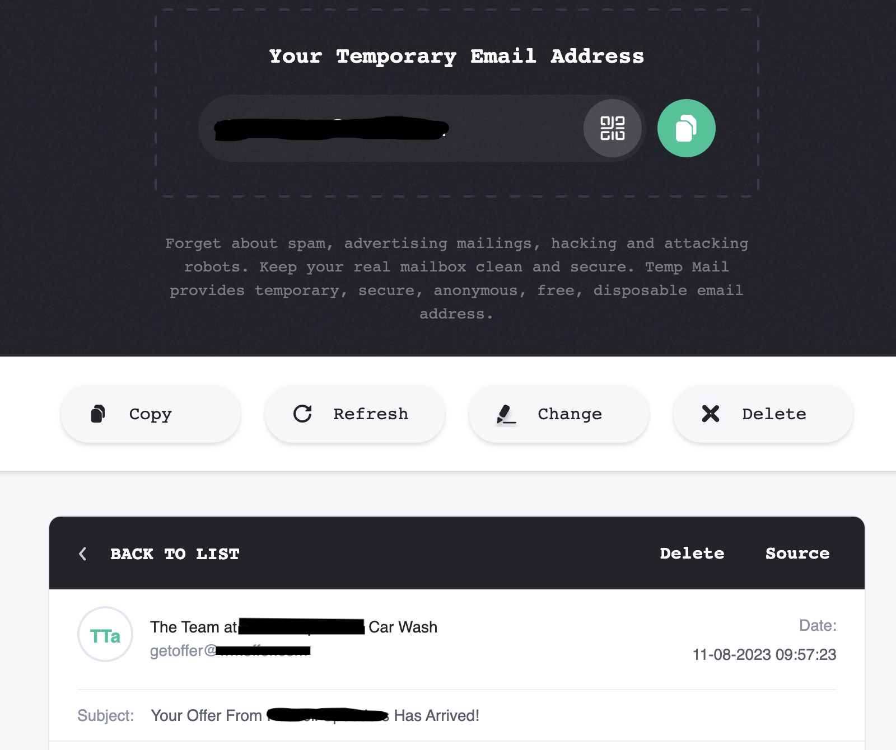
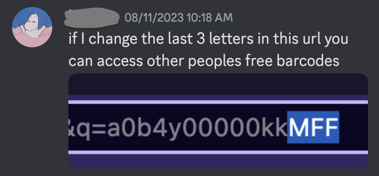
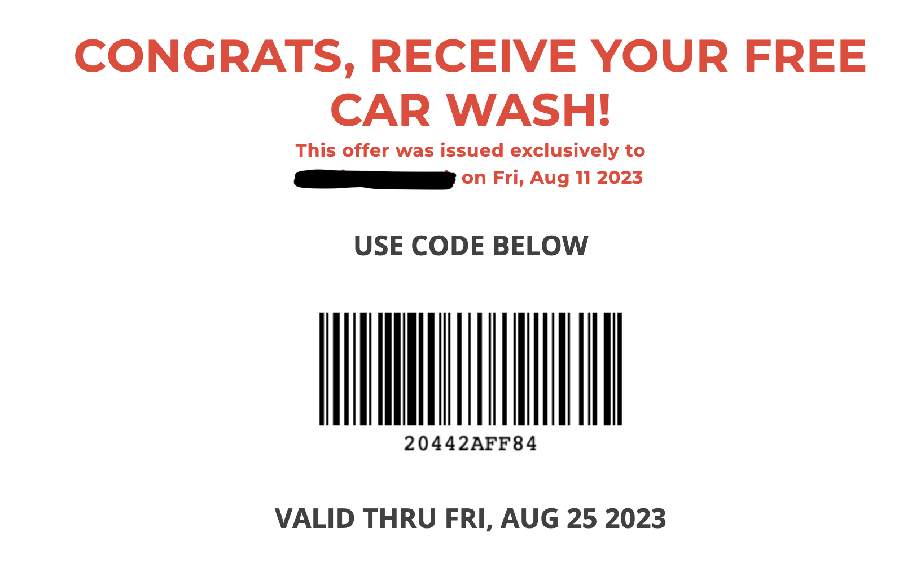
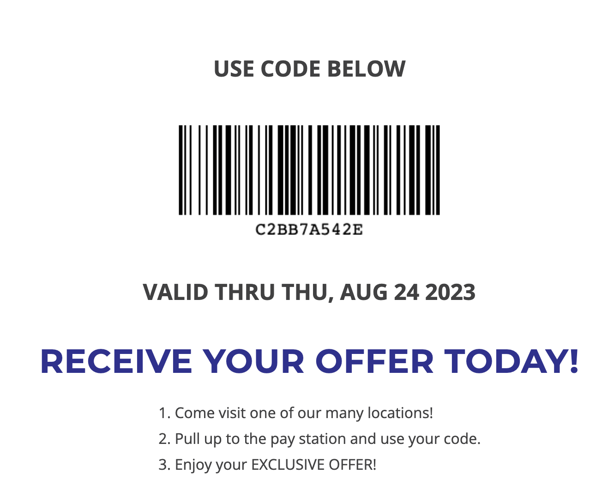
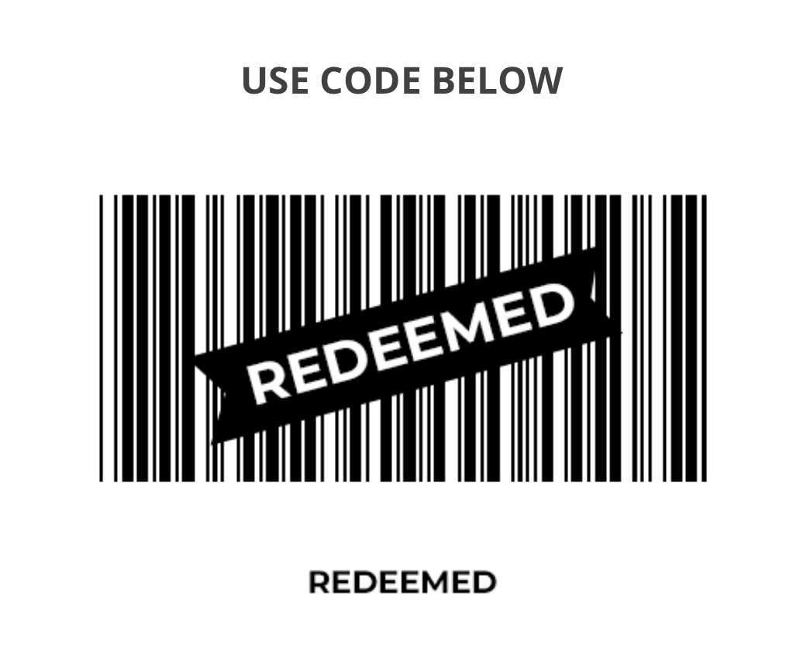
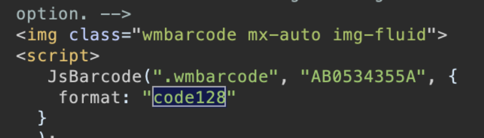

> [!CAUTION]
> Always report security vulnerabilities safely and securely, never exploit them for your benefit.

### Preamble

In the beginning of August, I took a trip down to Missouri to visit my parents, as they were moving into a new house there. The drive was only about 6 hours, which is just down the street for any Midwesterner. But by the time I was back from the week-long trip, my car was absolutely filthy. Bugs were scattered across every surface on the front of my car, even after cleaning it off on the way back. I arrived home late after driving all day, was annoyed with the mess, but I told myself I'd take care of it tomorrow.

When the next day came, I faced a dilema: Wash my car by hand in the 90 degree summer heat, or pay an excruciating sum of $10 to have it done for me. But then, I suddenly remembered a once in a lifetime deal a carwash was offering in town.

### The special

A local carwash was running a simple special: one free carwash per customer. My friend sent me a picture of a QR code that led to a website where you could input your:

- Name
- Phone number
- Email

and they would send you a link for a free carwash! Pretty cool.

The only problem is, I already used my free code a few weeks ago. But I got to thinking - when I originally did this, they sent me my free carwash link via text and email. Were both of these fields really necessary to receive a code at all? Or only one?

> flyer with scannable QR code

### Temporary email

I figured if they sent out the free wash link over both text and email, most likely only one was necessary even if the form required both to be filled out. I signed up for a quick "temp email" service and tried my luck with the form. A short 10 seconds later, I received a brand new free wash link I could use at my disposal.

While this was cool, and I already achieved my goal of getting another free carwash, I wanted more. After opening up the new link I just received in my phones browser, I noticed something strange next to my old wash link from 2 weeks prior.

### Going deeper

Looking at the URL's of both codes side by side, I noticed that there wasn't much separating these two resources. In fact the entirety of both URL's are identical, separated only by a few characters. What happens if I change those characters?

> a claimed, unredeemed code

I was able to access other users free carwash codes and potentially use them as my own.
But this begs the question: Can I access pre-existing codes that have not been assigned?

Absolutely.

I played around with the URL more and quickly found other codes that were not yet assigned to users.

> unclaimed, unredeemed code"

Finding some free codes is cool and all, but over time these will be assigned to users and not available anymore once they have been used.

Once a code has been used, the barcode image updates with a "REDEEMED" banner over itself, so the barcode scanner will not be able to read it anymore.

> redeemed code

### Automation

I quickly got to work on a way to find unredeemed codes automatically. With the help of a friend, we wrote a python script to iterate through URL's and only return links that were valid and unassigned.

All valid and unassigned codes returned with a JsBarcode format of code128 within the HTML response, making scraping these results pretty easy.

After running the script for a day, I was able to find nearly 100+ links for unredeemed codes. While this was very cool, the only downside was how long it took to run. The script simply iterated through every single alphanumeric character (a-z, A-Z, 0-9) and as such, took quite awhile to run.

### What's going on here?

What we're doing here is simple URL tampering and iteration to find resources we're not really supposed to access. In web security, this is known as an [IDOR (Insecure Direct Object Reference)](https://developer.mozilla.org/en-US/docs/Web/Security/Attacks/IDOR). This can manifest itself in several different ways including database access, static files, or session ID's.

### Conclusion

This research was done simply out of curiosity and allowed me to explore some web security concepts in the wild for the first time.